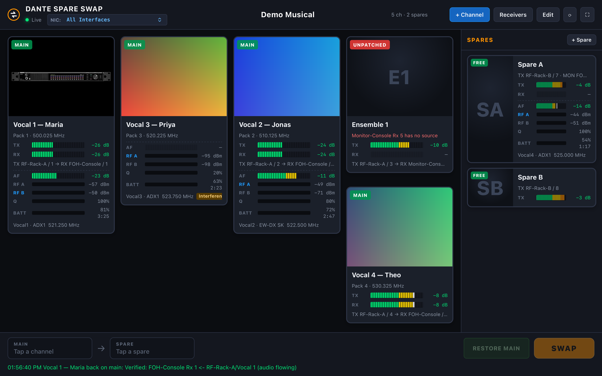
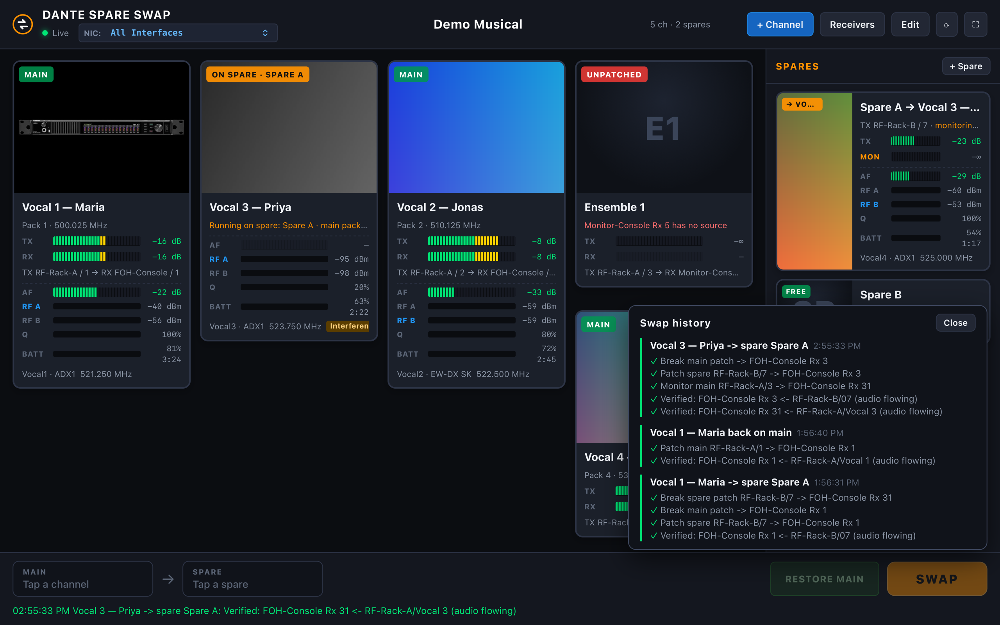
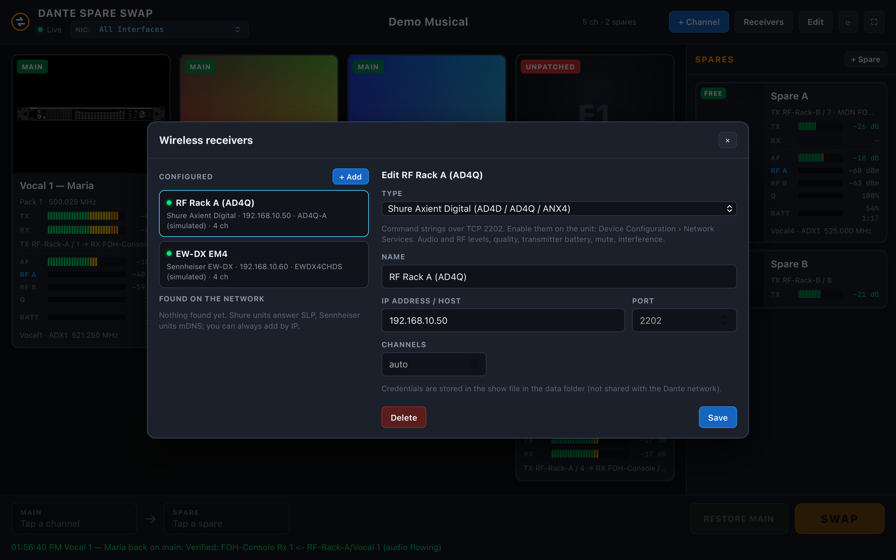
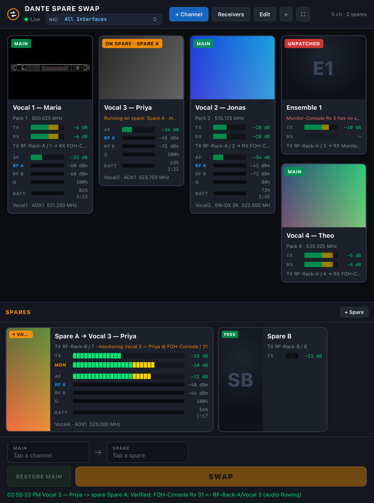

# Dante Spare Swap

[](https://github.com/mbsound/Dante-Spare-Swap/actions/workflows/ci.yml)
[](LICENSE)
[](https://nodejs.org)
[](package.json)

Fast main / spare patching for theatrical **Audinate Dante** networks. When an RF pack goes bad mid-show, tap the channel, tap a spare, hit **SWAP**: the spare's transmitter is patched into that channel's receiver and the show carries on. Every step is verified against what the receiver reports back.

Built on the [Dante Audio Meter Bridge](https://github.com/mbsound/Dante-Meter-Bridge): the same discovery and metering engine, plus receiver-side routing control.

- **No Dante Controller required.** Discovery, meters and routing talk to the devices directly. Verified on Yamaha Rio3224-D and Dante Virtual Soundcard.
- **Zero dependencies.** Pure Node.js core modules. No `npm install`, no build step.
- **Any browser, any screen.** Run it on the RF laptop; use it from an iPad at the mix position or a phone backstage.
- **Optional wireless-receiver readouts.** Link a card to a channel on a Shure Axient Digital or Sennheiser receiver and see RF, audio, quality and battery beside the Dante meters.



*One card per channel. Cards show Dante meters, RF receiver readouts, or both; the tray on the right holds the spares.*

---

## Contents

- [How a show is set up](#how-a-show-is-set-up)
- [The swap](#the-swap)
- [Monitoring the faulty pack](#monitoring-the-faulty-pack)
- [Wireless receivers (optional)](#wireless-receivers-optional)
- [Quick start](#quick-start)
- [Options and the show file](#options-and-the-show-file)
- [How it works](#how-it-works)
- [JSON API](#json-api)
- [Network and firewall](#network-and-firewall)
- [Development](#development)

---

## How a show is set up

1. **Channels** are cards, one per RF mic (or any Dante path). Press **+ Channel** and give it a name, a picture (choose, drag-and-drop or paste a headshot; in Edit mode you can also drop an image straight onto a card) and two paths:
   - **Transmit path**: the Dante transmitter channel the mic arrives on (for example `RF-Rack-A` Tx 3).
   - **Receive path**: where it lands (for example `FOH-Console` Rx 12).
2. **Spares** live in the tray on the right. Each spare is a transmit path you hold in reserve (the spare pack on `RF-Rack-B` Tx 7). A spare can also have a **monitor path**: the console input it is normally patched to so it can be checked (see [Monitoring the faulty pack](#monitoring-the-faulty-pack)).
3. Each card shows two meters, **TX** (the mic's own transmitter) and **RX** (what is actually arriving at the receiver), plus a status badge read live from the receiver's subscription:
   `MAIN` on its own transmitter, `ON SPARE · name`, `UNPATCHED`, or `OTHER SOURCE`.

Devices and channels are picked from lists populated by discovery, so names are never typed by hand. In **Edit** mode, drag cards to reorder them. The grid packs densely: two short cards stack beside a tall one.


*Channel settings: transmit path, receive path with the receiver's current source, and the optional wireless-receiver link with the card's view choice.*

## The swap

Tap a channel, tap a spare, press **SWAP**. In the background:

1. If the spare's transmitter is patched to any receiver, those patches are broken.
2. The channel's own transmitter → receiver patch is broken.
3. The spare's transmitter is patched into the channel's receiver.
4. (Optional, see below) the channel's own transmitter is patched into the spare's monitor input.
5. The receiver is re-read and the result is verified and logged.

Afterwards the channel's card goes grey with an **ON SPARE** badge. Its TX meter keeps showing the *main* transmitter, so the faulty pack can be diagnosed while the spare carries the show. In the tray, the spare inherits the channel's picture and name so everyone can see what it is now doing.

**RESTORE MAIN** puts the channel's own transmitter back into its receiver and frees the spare.

Every step is a standard Dante receiver subscription change, the same thing Dante Controller does when you click a crosspoint. Transmitters are never configured and nothing else on the network is touched. The status line at the bottom shows the last result; click it for the full history with every step.



*Vocal 3 is running on Spare A. The card is greyed with its own pack still metered; Spare A has taken Vocal 3's picture and name and shows a MON meter for the faulty pack. The history drawer lists every step of the swap.*

## Monitoring the faulty pack

Spare packs are often patched to a console input or listen bus so they can be checked. Give a spare a **Monitor path** in its settings and tick **patch the main mic's transmitter into this input when swapped in**. Then a swap also patches the channel's own (faulty) transmitter into the spare's monitor input, so the console can listen to the bad pack while the spare carries the show. The spare card shows a **MON** meter for it.

On restore, the spare's own transmitter is patched back into its monitor input. Leave the option off and the spare's monitor patch is simply cleared during a swap. The option is per spare, so you can mix both behaviours.

## Wireless receivers (optional)

A card can also be linked to a channel on an RF receiver, so the operator sees the pack itself, not just its Dante audio. This is a choice per card: **Dante meters**, **RF parameters**, or **both**. RF parameters are AF level, RF A and B with the active antenna highlighted, link quality, transmitter battery with time remaining, transmitter name and model, frequency, mute and warnings such as interference. Cards with no receiver link behave as before.

Add receivers with the **Receivers** button (they are also found on the network: Shure units via SLP, Sennheiser units via mDNS), then pick the receiver and channel in the card's settings.



*The receivers dialog: configured units with live state, units found on the network, and the settings for the selected one.*

| Receiver | How it is read |
|---|---|
| **Shure Axient Digital AD4D, AD4Q, ANX4** | Shure's documented *command strings* over TCP 2202: `METER_RATE` + `SAMPLE` for audio, RF per antenna and channel quality; `TX_*` reports for the transmitter and its battery. Turn command strings on in the unit's Network Services menu. |
| **Sennheiser EW-DX EM 2 / EM 4, firmware 4.0+** | SSCv2 (HTTPS 443, user `api`, SSE subscriptions). Allow third-party access on the receiver and set its password. EW-D transmitters paired to an EW-DX receiver are covered. |
| **Sennheiser EW-DX, firmware before 4.0** | Sound Control v1 (JSON over UDP 45) with subscriptions. |
| **Sennheiser Spectera** | SSCv2 (HTTPS 443, user `controlSennheiser`). One channel per paired mobile device, in the base station's order. Audio level mapping is best effort. |
| **Sennheiser EM 6000** | Sound Control v1 over UDP 45 using the EW-DX address layout. The public docs do not list the EM 6000 methods, so treat this as unverified. |

EW-D receivers themselves (non-DX) have no network control and cannot be linked.

The receiver clients are written to the published protocol documents. The Dante side has been run against real devices; the receiver clients have not yet. Receiver credentials live in the show file in the data folder, nowhere else.

---

## Quick start

| Platform | First time (installs Node.js if needed) | Every day after |
|---|---|---|
| **macOS** | `First Time Running - Click Here - Mac.command` | `Start Dante Spare Swap - Mac.command` |
| **Windows** | `First Time Running - Click Here - Windows.bat` | `Start Dante Spare Swap - Windows.bat` |

If Node.js 18 or newer isn't installed, the first-time scripts install the current LTS release (Homebrew or winget when available, otherwise straight from nodejs.org with the checksum verified), then start the app and open your browser.

> **macOS:** if the file is blocked as coming from an unidentified developer, open **System Settings → Privacy & Security** and click **Open Anyway**.

Or from a terminal:

```bash
git clone https://github.com/mbsound/Dante-Spare-Swap.git
cd Dante-Spare-Swap
npm start
```

Then open <http://localhost:8753>. From another device on the same network use `http://<this-computer's-ip>:8753` (the addresses are printed at startup).

### Rehearse without hardware

```bash
node server.js --demo
```

Demo mode simulates two RF racks and two consoles with moving meters and a working routing table, and any receivers you add become simulated units. Build your show file against it, then start normally on the real network. The screenshots on this page were taken in demo mode.



*On a tablet or phone the spares tray moves below the cards and the swap bar stretches across the bottom.*

## Options and the show file

```
node server.js [options]

  -i, --nic <ip|name>   Network interface to use for Dante (IP address or name, e.g. en6)
  -p, --port <port>     Web UI port (default: 8753)
      --host <address>  Address the web UI listens on (default: 0.0.0.0, all interfaces)
  -d, --data <dir>      Folder for the show file and pictures (default: ./data)
  -c, --config <file>   Config file (default: ./dante-swap.config.json if present)
      --open            Open the UI in the default browser once started
      --demo            Simulated Dante network (rehearse the UI with no hardware)
      --debug           Verbose logging
  -v, --version         Print version and exit
  -h, --help            Show help
```

Environment variables `DANTE_IP`, `PORT`, `HOST`, `DATA_DIR` and `DEBUG=1` work too. Copy `dante-swap.config.example.json` to `dante-swap.config.json` for a persistent config (git-ignored). If you don't pick a NIC, the app uses the first link-local (`169.254.x.x`) interface, the Dante default, and switches back to it if it disappears and returns.

**The show file.** Everything you set up lives in `data/show.json`, with pictures in `data/images/`. Copy the `data` folder to move a show between computers, or point `--data` at a folder per production. The folder is git-ignored.

---

## How it works

```
Dante devices ──(UDP)──▶ Spare Swap (Node.js) ──(WebSocket)──▶ Browsers
RF receivers ──(TCP/UDP/HTTPS)──┘
```

| What | How |
|---|---|
| Discovery | mDNS (`_netaudio-arc._udp`, `_netaudio-cmc._udp`), Dante heartbeats, device-info multicast and ARP probing |
| Names, channels, routing | ARC queries every 3 s. Older devices answer the classic queries; newer firmware (Dante Virtual Soundcard, Yamaha Rio, Prodigy and others) is read through the paged channel inventory it expects. Canonical Tx channel names are read because receivers subscribe with them. |
| Levels | A metering subscription to each device (UDP 8800); devices stream levels to UDP 8751, forwarded to browsers 20 times a second |
| Routing changes | An ARC subscription message (`0x3010`) to the **receiver**, naming the transmitter device and channel; an empty name clears the subscription. The receiver is re-read 1.5 s later to verify. |
| Receiver readouts | One client per receiver (see the table above); telemetry is normalised and sent to browsers 5 times a second |

Verified on a theatre network with two Yamaha Rio3224-D and a Dante Virtual Soundcard (all modern-ARC devices): patches in both directions, then a full swap with monitor path and a restore, every step reading back as connected.

## JSON API

Everything the UI does is available over HTTP, which makes it straightforward to trigger a swap from a Stream Deck or a show-control system.

| Endpoint | Description |
|---|---|
| `GET /api/show` | Channels, spares, receivers and swap state |
| `POST /api/channels`, `PATCH /api/channels/:id`, `DELETE /api/channels/:id` | Manage cards (`{ name, image, tx:{device,channel}, rx:{device,channel}, notes, rf:{receiverId,channel}, view }`) |
| `POST /api/spares`, `PATCH /api/spares/:id`, `DELETE /api/spares/:id` | Manage spares (`{ name, image, tx, rx, monitorMain, rf, view }`; `rx` is the optional monitor path) |
| `POST /api/reorder` | `{ channels: [ids] }` or `{ spares: [ids] }` |
| `POST /api/images` | `{ dataUrl }` → `{ file }` (picture stored in the data folder) |
| `POST /api/swap` | `{ channelId, spareId }` → result with each step |
| `POST /api/restore` | `{ channelId }` |
| `POST /api/patch` | `{ rx: {device, channel}, tx: {device, channel} \| null }`: set or clear one subscription directly; replies with the receiver's state after 1.5 s |
| `GET /api/history` | Recent swap results |
| `GET /api/receivers`, `POST /api/receivers`, `PATCH /api/receivers/:id`, `DELETE /api/receivers/:id` | Wireless receivers (`{ name, brand, host, port, username, password, channels }`); GET includes live state and discovered units |
| `GET /api/rf` | Current telemetry for every receiver channel |
| `GET /api/devices`, `GET /api/status`, `GET /api/interfaces`, `POST /api/interface`, `POST /api/refresh` | Network, as in the Meter Bridge |
| `GET /api/diagnostics` | Per-device ports, ARC protocol, packet counters, multicast health, receiver state |

Browsers receive the same data over a WebSocket at `/ws`: `hello`, `devices`, `show`, `meters` (20 Hz), `rf` (5 Hz) and `result` messages.

## Network and firewall

Allow Node.js to accept incoming connections. The server listens on:

- **UDP 8751**: metering stream (or the fallback port shown in the log)
- **UDP 8702, 8708**: Dante device-info and heartbeat multicast
- **UDP 5353**: mDNS (or a free port if the OS is already using 5353)
- **UDP 8427**: Shure SLP announcements (receiver discovery)
- **TCP 8753** (or your `--port`): the web UI

It sends queries to Dante devices on UDP 4440, 4455, 8700, 8702, 8800 and 38800, and to receivers on TCP 2202 (Shure), UDP 45 and TCP 443 (Sennheiser). Replies come back to temporary ports, which stateful firewalls allow automatically.

On macOS, accept the "allow incoming connections" prompt the first time you run it. On Windows, allow Node.js through Windows Defender Firewall on **Private** networks; a Public profile silently drops the multicast and meter streams.

## Development

```bash
npm test      # unit + integration tests (node:test), no hardware needed
npm run dev   # restart on file changes
```

Code layout: `lib/dante/` is the protocol layer, kept in step with the [Dante Meter Bridge](https://github.com/mbsound/Dante-Meter-Bridge) (currently its v2.3.0) plus this app's routing control; `packets.js` is pure and unit-tested byte-for-byte. `lib/show/` holds the show file (`store.js`) and the swap sequence (`swap.js`). `lib/rf/` talks to wireless receivers: `shure.js` (command strings), `ssc1.js` (Sound Control over UDP), `ssc2.js` (SSCv2 REST + SSE), `discovery.js` (SLP + mDNS) and `manager.js`. `lib/web/` is the HTTP / WebSocket layer. `public/` is the browser UI.

The swap logic is tested against a fake engine, the receiver clients against fake units speaking their protocols, and the HTTP API end to end.

## Contributing

Issues and pull requests are welcome at <https://github.com/mbsound/Dante-Spare-Swap/issues>. When reporting a device that misbehaves, include `GET /api/diagnostics` and the output of `node server.js --debug`.

## License

[MIT](LICENSE)

*Dante is a registered trademark of Audinate Pty Ltd. Shure and Axient are trademarks of Shure Inc. Sennheiser, EW-DX and Spectera are trademarks of Sennheiser electronic SE & Co. KG. This project is independent and not affiliated with or endorsed by any of them.*
